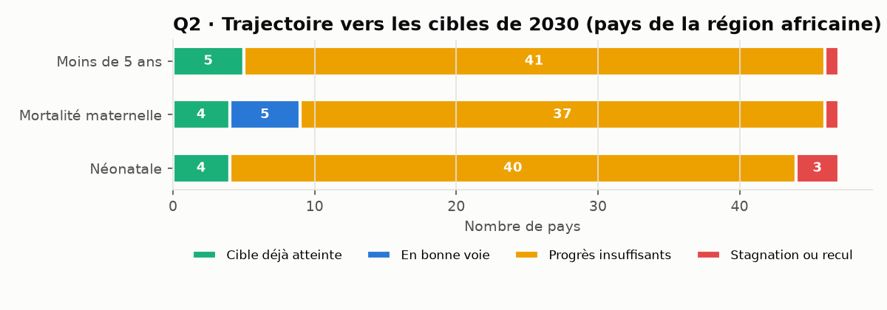
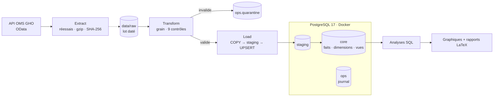

# 🌍 Santé mondiale : les ODD 3 en Afrique avec les données de l'OMS

🇬🇧 [English version](README.md) · 🇫🇷 **Français**


> Un **pipeline ETL de niveau production** qui charge 9 indicateurs de l'Organisation mondiale de la santé dans un entrepôt
> **PostgreSQL** conteneurisé : grain explicite, contrôles de qualité avec quarantaine, **UPSERT idempotent** et journal des exécutions.
> Il répond ensuite à quatre questions sur la progression de la région africaine vers les cibles 2030 de l'ODD 3.

> 🎭 **Scénario fictif, données réelles.** Le client, l'ONG *Initiative Baobab Santé*, est inventé pour simuler une mission complète,
> du brief à la recette. Les données proviennent de l'API publique de l'**Observatoire mondial de la santé de l'OMS**.
> Ce projet n'est ni commandé, ni validé, ni affilié à l'Organisation mondiale de la santé.

## 📄 Rapports

| | |
|---|---|
| 🇫🇷 **Rapport d'ingénierie des données (PDF, français)** | [Rapport_OMS_ODD3_FR.pdf](docs/livraison/Rapport_OMS_ODD3_FR.pdf) |
| 🇬🇧 **Data engineering report (PDF, English)** | [Report_WHO_SDG3_EN.pdf](docs/livraison/Report_WHO_SDG3_EN.pdf) |

21 pages, rédigées en LaTeX ([sources](docs/rapport/)).

---

## 💼 Le contexte client

Une ONG suit chaque année la progression des pays africains vers l'ODD 3. Son processus était **manuel** (téléchargements, copier-coller
dans Excel), non reproductible, et avait déjà produit un chiffre faux présenté au conseil : un tableau **mélangeait plusieurs catégories**.
Le vrai besoin était d'abord un **système de données fiable**, et ensuite une analyse.

| # | Question business | Décision éclairée |
|---|---|---|
| **Q1** | Où en sont les pays de la région africaine par rapport aux cibles ODD 3 de 2030 ? | Diagnostic annuel du conseil |
| **Q2** | À leur rythme actuel, quels pays atteindront ces cibles d'ici 2030 ? | Priorisation des pays à financer |
| **Q3** | Quel est l'écart de mortalité infantile entre les ménages les plus pauvres et les plus riches ? | Ciblage des programmes |
| **Q4** | Les moyens du système de santé vont-ils de pair avec de meilleurs résultats ? | Choix des leviers |

## 📊 Résultats clés (région africaine de l'OMS, 47 pays)

| # | Constat |
|---|---|
| **Q1** | Seuls **5 pays sur 47** ont atteint la cible de mortalité des moins de 5 ans (≤ 25 ‰), et 4 celle de la mortalité maternelle. |
| **Q2** | **Aucun** pays hors cible n'est en voie d'atteindre l'objectif de mortalité infantile. Le pays médian progresse de **3,0 % par an**, contre **12,4 %** nécessaires : **quatre fois trop lentement**. |
| **Q3** | Un enfant des 20 % de ménages les plus pauvres a **1,7 fois plus de risque** de mourir avant 5 ans (2,5 fois au Nigeria). L'écart absolu se réduit, mais **l'écart relatif se creuse depuis 2000**. |
| **Q4** | Les **accouchements assistés** sont le moyen le plus lié à une faible mortalité (ρ de Spearman = −0,75). |



## 🏗️ Architecture



## 🛠️ Points forts côté data engineering

| Pratique | Mise en œuvre |
|---|---|
| **Grain explicite** | Une même valeur pays-année existe par sexe, âge et **quintile de richesse** (dimension cachée découverte lors de l'exploration). Clé métier sur 7 colonnes, `UNIQUE NULLS NOT DISTINCT`. |
| **Base en couches** | `staging` (transit), `core` (faits, dimensions, vues d'analyse), `ops` (journal, quarantaine). |
| **UPSERT idempotent et mesurable** | `COPY` vers staging, puis `INSERT … ON CONFLICT … DO UPDATE … WHERE … IS DISTINCT FROM`. À la relance : **0 insérée, 0 mise à jour, 129 368 inchangées**. |
| **Qualité des données** | 9 règles vérifiées **avant** chargement. Les lignes invalides vont en quarantaine avec leur motif et leur JSON d'origine. |
| **Seuils calibrés** | Le premier passage a mis en quarantaine 25 « valeurs aberrantes » qui étaient de vraies crises historiques (Cambodge 1975-78, Rwanda 1994). Les seuils ont été remplacés par des limites logiques ([ADR 003](docs/decisions/2026-10-22-003-controles-qualite.md)). |
| **Gestion des secrets** | Identifiants dans `.env` (ignoré par Git), modèle `.env.example`, base accessible uniquement sur `127.0.0.1`. |
| **Tests** | 22 tests `pytest` : 17 unitaires sur un extrait réel de l'API, 5 d'intégration sur une base PostgreSQL dédiée. Ils ont détecté un vrai bug `None` / `NaN`. |
| **Diagnostic de performance** | Chargement en 156 s. Mesure étape par étape : `COPY` 0,9 s, UPSERT 2,8 s, mais **connexion 130 s** (`localhost` résolu d'abord en IPv6). Correction → **10 s** au total. |
| **Recette** | 7 critères sur 7 conformes sur un clone neuf avec une base vierge, extraction réelle comprise. |

## 🚀 Démarrage rapide

**Prérequis :** Python 3.12 ou plus, Docker Desktop, Git.

```bash
git clone https://github.com/MediJr/who-sdg3-health-etl.git
cd who-sdg3-health-etl

copy .env.example .env            # puis choisir un mot de passe
docker compose up -d              # PostgreSQL 17 sur 127.0.0.1:5433

python -m venv .venv
.venv\Scripts\activate
pip install -r requirements.txt

python -m src.pipeline            # extraction + chargement + rapport (~3 min)
pytest                            # 22 tests
```

Rejouer un lot brut sans appeler l'API : `python -m src.pipeline --run-date 2026-10-22`.

## 📚 Documentation de la mission

| Étape | Document |
|---|---|
| 1. Demande | [Brief client](docs/mission/2026-10-22-01-brief-client.md) |
| 2. Cadrage | [Compte rendu](docs/mission/2026-10-22-02-compte-rendu-cadrage.md) |
| 3. Engagement | [Cahier des charges](docs/mission/2026-10-22-03-cahier-des-charges.md) |
| 4. Réalisation | [Journal de bord](docs/journal/2026-10-22.md) · [ADR](docs/decisions/) · [Dictionnaire de données](docs/dictionnaire-de-donnees.md) |
| 5. Recette | [Rapports (PDF)](docs/livraison/) · [PV de recette](docs/livraison/2026-10-22-pv-recette.md) |

---

## 👤 Auteur

**Lumu Bamana Manasse**, data engineer en reconversion depuis la data analyse
(Google Data Analytics Professional Certificate, 2026) · GitHub : [@MediJr](https://github.com/MediJr)

**Niveau 1** d'un parcours de 7 projets. Niveau 0 :
[Ubisoft vs Electronic Arts, ETL Steam](https://github.com/MediJr/ubisoft-vs-ea-steam-etl).

## 📄 Licence et données

Code sous licence [MIT](LICENSE). Données : **Organisation mondiale de la santé, Observatoire mondial de la santé**
(https://www.who.int/data/gho), utilisées selon la politique de données de l'OMS, à des fins non commerciales.
