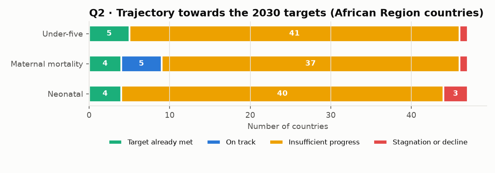
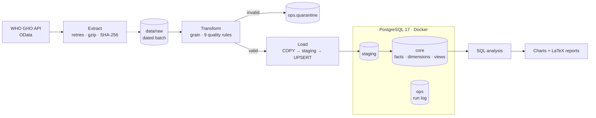

# 🌍 Global health: SDG 3 in Africa with WHO data

🇬🇧 **English** · 🇫🇷 [Version française](README.fr.md)


> A **production-style ETL pipeline** that loads 9 World Health Organization indicators into a containerised **PostgreSQL**
> warehouse, with an explicit grain, quality checks with quarantine, an **idempotent upsert**, and a run log. It then answers
> four questions on the African Region's progress towards the 2030 Sustainable Development Goal 3 targets.

> 🎭 **Fictional scenario, real data.** The client, the NGO *Initiative Baobab Santé*, is invented to simulate a complete
> engagement, from brief to acceptance testing. The data comes from the **WHO Global Health Observatory** public API.
> This project is not commissioned, endorsed by or affiliated with the World Health Organization.

## 📄 Reports

| | |
|---|---|
| 🇬🇧 **Data engineering report (PDF, English)** | [Report_WHO_SDG3_EN.pdf](docs/livraison/Report_WHO_SDG3_EN.pdf) |
| 🇫🇷 **Rapport d'ingénierie des données (PDF, français)** | [Rapport_OMS_ODD3_FR.pdf](docs/livraison/Rapport_OMS_ODD3_FR.pdf) |

21 pages, written in LaTeX ([sources](docs/rapport/)): executive summary, scoping, data sources, architecture, pipeline design,
data model, data quality, security, operations and incident reports, testing and acceptance, results, limitations and roadmap.

---

## 💼 Business context

An NGO tracks African countries' progress towards SDG 3 every year. Its process was **manual** (downloads, copy-pasting into Excel),
not reproducible, and had already produced a wrong figure presented to its board: a table **mixed several data categories**.
The real need was a **reliable data system** first, and an analysis second.

| # | Business question | Decision supported |
|---|---|---|
| **Q1** | Where do African Region countries stand against the 2030 SDG 3 targets? | Annual board diagnosis |
| **Q2** | At their current pace, which countries will meet the targets by 2030? | Prioritising countries to fund |
| **Q3** | How large is the child mortality gap between the poorest and richest households? | Programme targeting |
| **Q4** | Are health system inputs associated with better outcomes? | Choice of levers |

## 📊 Key findings (WHO African Region, 47 countries)

| # | Finding |
|---|---|
| **Q1** | Only **5 of 47 countries** have met the under-five mortality target (≤ 25 per 1,000), and 4 the maternal mortality target. |
| **Q2** | **No** off-target country is on track for the under-five target. The median country cuts mortality by **3.0% a year**, against the **12.4%** needed: **four times too slow**. |
| **Q3** | A child from the poorest 20% of households is **1.7 times more likely** to die before age 5 (2.5 times in Nigeria). The absolute gap is shrinking, but the **relative gap has widened since 2000**. |
| **Q4** | **Skilled birth attendance** is the input most strongly associated with low mortality (Spearman ρ = −0.75). |



## 🏗️ Architecture



## 🛠️ Data engineering highlights

| Practice | Implementation |
|---|---|
| **Explicit grain** | The same country-year value exists by sex, age and **wealth quintile** (a hidden dimension found during exploration). Business key on 7 columns with `UNIQUE NULLS NOT DISTINCT`. |
| **Layered database** | `staging` (transit), `core` (facts, dimensions, analysis views), `ops` (run log, quarantine). |
| **Idempotent, measurable upsert** | `COPY` into staging, then `INSERT … ON CONFLICT … DO UPDATE … WHERE … IS DISTINCT FROM`. Re-run result: **0 inserted, 0 updated, 129,368 unchanged**. |
| **Data quality** | 9 rules checked **before** loading. Invalid rows go to a quarantine table with their reason and raw JSON. Invariant: extracted = loaded + quarantined. |
| **Calibrated thresholds** | First run quarantined 25 "outliers" that turned out to be real historical crises (Cambodia 1975–78, Rwanda 1994). Thresholds replaced by logical limits ([ADR 003](docs/decisions/2026-10-22-003-controles-qualite.md)). |
| **Secrets management** | Credentials in `.env` (git-ignored), secret-free `.env.example` template, database bound to `127.0.0.1` only. |
| **Testing** | 22 `pytest` tests: 17 unit tests on a real API extract, 5 integration tests on a dedicated PostgreSQL database. The tests caught a real `None`/`NaN` bug. |
| **Performance diagnosis** | Load took 156 s. Step-by-step timing showed `COPY` 0.9 s and upsert 2.8 s, but **connection 130 s** (`localhost` resolved to IPv6 first). Fix: `127.0.0.1` and a connection timeout → **10 s** total. |
| **Acceptance testing** | 7/7 criteria met on a fresh clone with a blank database, including a real API extraction. |

## 🧰 Tech stack

| Technology | Role |
|---|---|
| **Python 3.14** · `requests` · `pandas` | Extraction and transformation |
| **PostgreSQL 17** · **psycopg 3** | Warehouse, bulk `COPY`, upsert |
| **Docker Compose** | Reproducible database |
| **python-dotenv** | Secrets out of the code |
| **pytest** | Unit and integration tests |
| **matplotlib** · **LaTeX** | Bilingual charts and reports |

## 🚀 Quick start

**Requirements:** Python 3.12+, Docker Desktop, Git.

```bash
git clone https://github.com/MediJr/who-sdg3-health-etl.git
cd who-sdg3-health-etl

copy .env.example .env            # Windows (cp on macOS/Linux), then set a password
docker compose up -d              # PostgreSQL 17 on 127.0.0.1:5433

python -m venv .venv
.venv\Scripts\activate            # source .venv/bin/activate on macOS/Linux
pip install -r requirements.txt

python -m src.pipeline            # extract + load + report (~3 min)
pytest                            # 22 tests
```

Replay an existing raw batch without calling the API: `python -m src.pipeline --run-date 2026-10-22`.

**Query the warehouse** (any SQL client, e.g. DBeaver, on `127.0.0.1:5433`):

```sql
SELECT location_name, year, value
FROM core.v_latest
WHERE indicator_code = 'MDG_0000000007' AND who_region = 'AFR'
ORDER BY value DESC;
```

## 📁 Repository structure

```text
who-sdg3-health-etl/
├── src/
│   ├── config.py        ← indicators, SDG targets, quality bounds, DB settings (from .env)
│   ├── extract.py       ← E: WHO API, retries, gzip raw layer, SHA-256 manifest
│   ├── transform.py     ← T: grain, 9 quality rules, quarantine
│   ├── load.py          ← L: COPY → staging → upsert, run log
│   ├── report.py        ← charts (FR/EN) and query results
│   └── pipeline.py      ← entry point
├── sql/                 ← schema, views, Q0–Q4 analysis, acceptance checks
├── tests/               ← unit + integration tests, real API fixture
├── docs/
│   ├── mission/         ← brief, scoping minutes, statement of work (French)
│   ├── decisions/       ← 3 Architecture Decision Records
│   ├── journal/         ← dated work log, incidents
│   ├── livraison/       ← PDF reports, results, charts, acceptance sign-off
│   ├── rapport/         ← LaTeX sources
│   └── dictionnaire-de-donnees.md
├── docker-compose.yml · .env.example · requirements.txt · pytest.ini
└── CHANGELOG.md · LICENSE
```

## ⚠️ Limitations

- WHO figures are **modelled estimates** with uncertainty intervals.
- The 2030 projection assumes the **2015–2024 pace continues**.
- Q4 shows **correlations**, not causal effects.
- Only the **latest value** is kept: full revision history is planned for the next project.

## 📚 Engagement documents

| Step | Document |
|---|---|
| 1. Request | [Client brief](docs/mission/2026-10-22-01-brief-client.md) |
| 2. Scoping | [Meeting minutes](docs/mission/2026-10-22-02-compte-rendu-cadrage.md) |
| 3. Commitment | [Statement of work](docs/mission/2026-10-22-03-cahier-des-charges.md) |
| 4. Delivery | [Work log](docs/journal/2026-10-22.md) · [ADRs](docs/decisions/) · [Data dictionary](docs/dictionnaire-de-donnees.md) |
| 5. Acceptance | [Reports (PDF)](docs/livraison/) · [Acceptance sign-off](docs/livraison/2026-10-22-pv-recette.md) |

*Engagement documents are written in French, as for a French-speaking client.*

---

## 👤 Author

**Lumu Bamana Manasse**, data engineer transitioning from data analytics
(Google Data Analytics Professional Certificate, 2026) · GitHub: [@MediJr](https://github.com/MediJr)

This is **level 1** of a seven-project data engineering portfolio. Level 0:
[Ubisoft vs Electronic Arts, Steam ETL](https://github.com/MediJr/ubisoft-vs-ea-steam-etl).

## 📄 License and data

Code released under the [MIT License](LICENSE). Data: **World Health Organization, Global Health Observatory**
(https://www.who.int/data/gho), used under WHO's data policy for non-commercial purposes.
