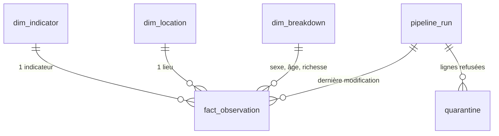

# Dictionnaire de données

> Base : PostgreSQL 17 (`docker compose up -d`) · Schéma : [`sql/00_schema.sql`](../sql/00_schema.sql) ·
> Vues : [`sql/01_views.sql`](../sql/01_views.sql) · Mise à jour : UPSERT à chaque exécution

## Organisation en schémas

| Schéma | Rôle | Qui y accède ? |
|---|---|---|
| `core` | Données propres, de référence, et vues d'analyse | **L'équipe du client**, en SQL |
| `staging` | Zone de transit, vidée à chaque exécution | Le pipeline uniquement |
| `ops` | Journal des exécutions et quarantaine | L'exploitant du pipeline |

---

## `core.fact_observation` : valeurs des indicateurs

**Grain :** une ligne par indicateur × lieu × année × sexe × tranche d'âge × quintile de richesse.
**Clé métier :** ces sept colonnes, unique avec `NULLS NOT DISTINCT`. **Clé technique :** `observation_id`.

| Colonne | Type | Description |
|---|---|---|
| `observation_id` | BIGINT | Identifiant technique, généré par la base |
| `indicator_code` | TEXT | Code OMS de l'indicateur → `dim_indicator` |
| `location_type`, `location_code` | TEXT | Type et code du lieu (`COUNTRY` / `SEN`, `REGION` / `AFR`, `GLOBAL` / `GLOBAL`…) → `dim_location` |
| `year` | INTEGER | Année de référence |
| `sex` | TEXT | `SEX_BTSX` (les deux sexes), `SEX_FMLE`, `SEX_MLE`, ou NULL si l'indicateur n'est pas ventilé |
| `age_group` | TEXT | Tranche d'âge (ex. `AGEGROUP_YEARSUNDER5`), ou NULL |
| `wealth_quintile` | TEXT | `WEALTHQUINTILE_WQ1` (20 % les plus pauvres) … `WQ5` (20 % les plus riches), `TOTL` (ensemble), ou NULL |
| `value` | NUMERIC | Valeur estimée |
| `value_low`, `value_high` | NUMERIC | Bornes de l'intervalle d'incertitude publié par l'OMS |
| `who_updated_at` | TIMESTAMPTZ | Dernière mise à jour de la valeur par l'OMS |
| `first_loaded_at` | TIMESTAMPTZ | Premier chargement dans la base |
| `last_changed_at` | TIMESTAMPTZ | Dernière modification détectée par le pipeline (révision de l'OMS) |
| `last_run_id` | BIGINT | Exécution du pipeline à l'origine de la dernière modification → `ops.pipeline_run` |

> ⚠️ **Piège du grain :** pour obtenir **une** valeur nationale, il faut filtrer `sex = 'SEX_BTSX'` (ou NULL) **et**
> `wealth_quintile = 'WEALTHQUINTILE_TOTL'` (ou NULL). La vue `core.v_national` le fait pour vous.

## `core.dim_indicator` : indicateurs suivis

| Colonne | Description |
|---|---|
| `indicator_code` | Code OMS (clé primaire) |
| `name_en` / `name_fr` | Libellé officiel de l'OMS / libellé français |
| `unit` | Unité |
| `role` | `resultat` (cible ODD), `moyen` (moyens du système de santé) ou `contexte` |
| `target_2030` | Cible chiffrée pour 2030, si elle existe |
| `target_direction` | `max` : la valeur doit passer **sous** la cible · `min` : la valeur doit passer **au-dessus** |
| `target_source` | Référence de la cible (ex. ODD 3.2.1) |

## `core.dim_location` : lieux

| Colonne | Description |
|---|---|
| `location_type` | `COUNTRY`, `REGION`, `GLOBAL`, `WORLDBANKINCOMEGROUP`, `UNSDGREGION`, `UNICEFREGION`, `MGHEREG` |
| `location_code` | Code ISO 3 pour les pays (ex. `SEN`), code OMS sinon (ex. `AFR`) |
| `name` | Nom anglais publié par l'OMS |
| `who_region` | Région OMS du pays (`AFR`, `AMR`, `EMR`, `EUR`, `SEAR`, `WPR`) ; NULL pour les autres types |

Clé primaire composée : `(location_type, location_code)`.

## `core.dim_breakdown` : valeurs de ventilation

| Colonne | Description |
|---|---|
| `breakdown_code` | Code OMS (ex. `SEX_FMLE`, `WEALTHQUINTILE_WQ1`) |
| `breakdown_type` | `SEX`, `AGEGROUP` ou `WEALTHQUINTILE` |
| `label` | Libellé anglais publié par l'OMS |

## Vues d'analyse

| Vue | Contenu |
|---|---|
| `core.v_national` | Valeur nationale totale (deux sexes, sans ventilation par richesse), avec les libellés et les cibles |
| `core.v_latest` | Dernière année disponible par indicateur et par lieu, à partir de `v_national` |

## `ops.pipeline_run` : journal des exécutions

| Colonne | Description |
|---|---|
| `run_id` | Numéro d'exécution |
| `raw_batch` | Lot brut traité (`AAAA-MM-JJ`) |
| `started_at`, `finished_at` | Début et fin |
| `status` | `running`, `success` ou `failed` |
| `rows_extracted` | Lignes extraites de l'API |
| `rows_inserted`, `rows_updated`, `rows_unchanged` | Résultat de l'UPSERT |
| `rows_quarantined` | Lignes refusées par les contrôles de qualité |

Invariant vérifié : `rows_extracted = rows_inserted + rows_updated + rows_unchanged + rows_quarantined`.

## `ops.quarantine` : lignes refusées

| Colonne | Description |
|---|---|
| `run_id` | Exécution concernée |
| `indicator_code` | Indicateur |
| `reason` | Motif(s) du refus, en clair |
| `raw_record` | Ligne d'origine, en JSON, telle que reçue de l'OMS |

---

## 🔒 Données personnelles

Les données de l'OMS sont **agrégées à l'échelle des pays et des régions** : la base ne contient **aucune donnée personnelle**.
Les identifiants de connexion sont stockés dans `.env`, exclu de Git.
