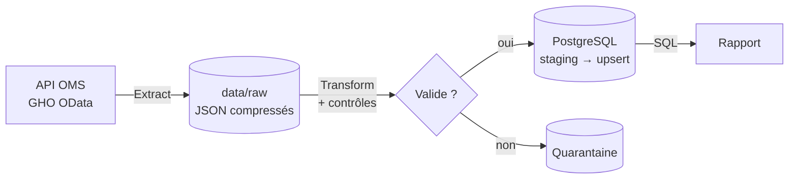

# 03 · Cahier des charges (Statement of Work)

> 🎭 **Scénario fictif** : voir le [brief client](2026-10-22-01-brief-client.md).

| | |
|---|---|
| **Référence** | IBS-2026-001 |
| **Version** | 1.0 |
| **Date** | 2026-10-22 |
| **Client** | Initiative Baobab Santé, représentée par Dr Mariam Koné |
| **Prestataire** | Data engineer indépendant |
| **Statut** | ✅ Validé par le client (voir section 11) |

---

## 1. Contexte

L'ONG suit chaque année la progression des pays africains vers les cibles de l'**ODD 3** (« Permettre à tous de vivre
en bonne santé »). Son processus actuel est manuel : téléchargements depuis le site de l'OMS, copier-coller dans Excel.
Il est non reproductible, ne trace pas les révisions et a déjà produit une erreur présentée au conseil d'administration.

## 2. Objectifs

1. **Automatiser** la collecte des indicateurs de l'OMS liés à l'ODD 3.
2. **Fiabiliser** les données : grain explicite, contrôles de qualité, suivi des révisions.
3. **Mettre à disposition** une base PostgreSQL interrogeable en SQL par l'équipe du client.
4. **Répondre** aux quatre questions business dans un rapport destiné au conseil.

## 3. Indicateurs

| Code OMS (GHO) | Indicateur | Rôle | Cible 2030 |
|---|---|---|---|
| `MDG_0000000026` | Taux de mortalité maternelle (pour 100 000 naissances vivantes) | Résultat | **< 70** (ODD 3.1) |
| `MDG_0000000007` | Mortalité des moins de 5 ans (pour 1 000 naissances vivantes) | Résultat | **≤ 25** (ODD 3.2) |
| `WHOSIS_000003` | Mortalité néonatale (pour 1 000 naissances vivantes) | Résultat | **≤ 12** (ODD 3.2) |
| `WHOSIS_000001` | Espérance de vie à la naissance (années) | Contexte | – |
| `WHOSIS_000002` | Espérance de vie en bonne santé (années) | Contexte | – |
| `WHS4_100` | Couverture vaccinale DTP3 chez les enfants d'un an (%) | Moyen | 90 % (Programme pour la vaccination à l'horizon 2030) |
| `MDG_0000000025` | Accouchements assistés par du personnel qualifié (%) | Moyen | – |
| `HWF_0001` | Médecins (pour 10 000 habitants) | Moyen | – |
| `GHED_CHE_pc_US_SHA2011` | Dépenses courantes de santé par habitant (USD) | Moyen | – |

## 4. Questions business

| # | Question | Méthode prévue |
|---|---|---|
| **Q1** | Où en sont les pays de la région africaine par rapport aux cibles ODD 3 de 2030 ? | Dernière valeur disponible par pays, comparée à la cible et à la moyenne mondiale |
| **Q2** | À leur rythme actuel, quels pays atteindront ces cibles d'ici 2030 ? | **Taux annuel moyen de réduction** (*ARR*, méthode du groupe interagences des Nations unies) depuis 2015, puis projection à 2030 |
| **Q3** | Quel est l'écart de mortalité des moins de 5 ans entre les ménages les plus pauvres et les plus riches ? | Rapport entre le quintile le plus pauvre (Q1) et le plus riche (Q5), à la dernière enquête disponible |
| **Q4** | Les moyens du système de santé vont-ils de pair avec de meilleurs résultats ? | Corrélations entre indicateurs de moyens et de résultats, sur la dernière année commune |

## 5. Périmètre

### ✅ Inclus
- Les 9 indicateurs ci-dessus, pour **tous les pays et régions** publiés par l'OMS (la base est complète)
- Les analyses portent sur la **région africaine de l'OMS** (code `AFR`), avec la valeur mondiale comme référence
- Toutes les ventilations publiées : sexe, tranche d'âge, quintile de richesse, etc.
- Les bornes d'incertitude (`Low`, `High`) et la date de dernière mise à jour par l'OMS

### ❌ Exclus
- Les données infranationales (régions, districts)
- Les sources autres que l'OMS (enquêtes nationales brutes, Banque mondiale)
- Un tableau de bord interactif et la planification automatique (le pipeline est relancé à la demande)
- Toute modélisation causale (Q4 est descriptive)

## 6. Livrables

| # | Livrable | Format |
|---|---|---|
| L1 | Pipeline ETL relançable en une commande | Code Python |
| L2 | Base PostgreSQL conteneurisée | Docker Compose |
| L3 | Tests automatisés | `pytest` |
| L4 | Requêtes d'analyse, une par question | Fichiers SQL |
| L5 | Rapport pour le conseil, en français et en anglais | PDF (LaTeX) |
| L6 | Documentation : README, dictionnaire de données, procédure d'exploitation | Markdown |
| L7 | Procès-verbal de recette | Markdown |

## 7. Architecture et technologies

| Technologie | Rôle | Pourquoi ce choix |
|---|---|---|
| **Python 3.14** | Langage du pipeline | Standard du data engineering |
| **requests** | Appels à l'API | Simple et fiable |
| **pandas** | Transformation | Adapté à environ 130 000 lignes |
| **PostgreSQL 17** | Base de données | Multi-utilisateur, contraintes fortes, `UPSERT` natif, standard du marché |
| **Docker Compose** | Exécution de PostgreSQL | Même base sur tous les postes, en une commande |
| **psycopg 3** | Connexion Python vers PostgreSQL | Pilote officiel moderne, chargement en masse (`COPY`) |
| **python-dotenv** | Lecture des secrets depuis `.env` | Aucun mot de passe dans le code |
| **pytest** | Tests automatisés | Standard Python |
| **matplotlib** | Graphiques | Figures du rapport, en français et en anglais |
| **LaTeX** | Rapport | Document professionnel versionné |

## 8. Données personnelles et sécurité

- Les données de l'OMS sont **agrégées** à l'échelle des pays : **aucune donnée personnelle**.
- Les **identifiants de la base** sont stockés dans un fichier `.env` exclu du dépôt Git. Un modèle sans secret (`.env.example`) est fourni.
- La base n'est exposée que sur la machine locale (`localhost`).

## 9. Hypothèses et risques

| Risque | Impact | Mesure |
|---|---|---|
| L'OMS modifie la structure de son API | Le pipeline échoue | Contrôle du schéma des réponses, échec explicite |
| Révision de valeurs par l'OMS | Chiffres différents d'une exécution à l'autre | `UPSERT` avec date de révision et compteurs de lignes modifiées |
| Mauvais grain (mélange de catégories) | Indicateurs faux | Clé métier unique sur toutes les dimensions |
| Valeurs aberrantes ou incohérentes | Analyses faussées | Contrôles de qualité et table de quarantaine |
| Données manquantes pour certains pays | Analyses incomplètes | Mesure de la couverture des données, documentée dans le rapport |

## 10. Critères d'acceptation (recette)

| # | Critère | Vérification |
|---|---|---|
| C1 | Le pipeline s'exécute de bout en bout en **une commande**, base comprise | Poste neuf : `docker compose up` puis la commande du README |
| C2 | Relancer le pipeline ne crée **aucun doublon** et ne modifie **aucune ligne** si l'OMS n'a rien changé | Compteurs « insérées / mises à jour / inchangées » |
| C3 | La clé métier couvre **toutes** les dimensions : aucun mélange de catégories | Contrainte d'unicité en base et test automatisé |
| C4 | Les lignes invalides sont **mises en quarantaine** avec leur motif, jamais perdues en silence | Requête sur la table de quarantaine |
| C5 | **Aucun secret** dans le dépôt Git | Recherche dans les fichiers versionnés |
| C6 | La suite de **tests passe** intégralement | `pytest` |
| C7 | Chaque question Q1 à Q4 a sa requête SQL et sa réponse argumentée dans le rapport | Relecture |

## 11. Validation

| | Client | Prestataire |
|---|---|---|
| **Nom** | Dr Mariam Koné | Data engineer |
| **Date** | 2026-10-22 | 2026-10-22 |
| **Mention** | Bon pour accord | Bon pour exécution |
